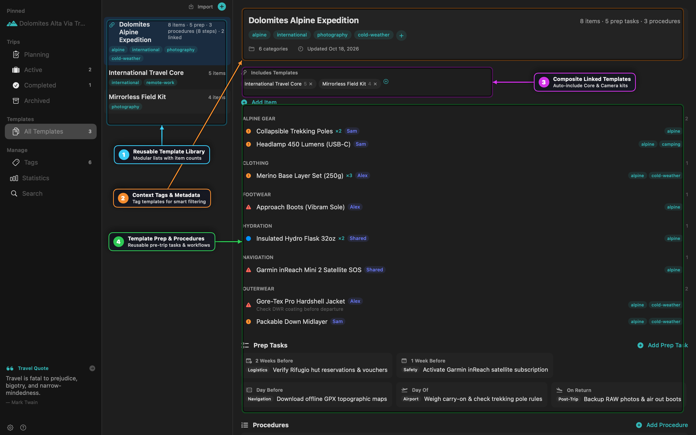
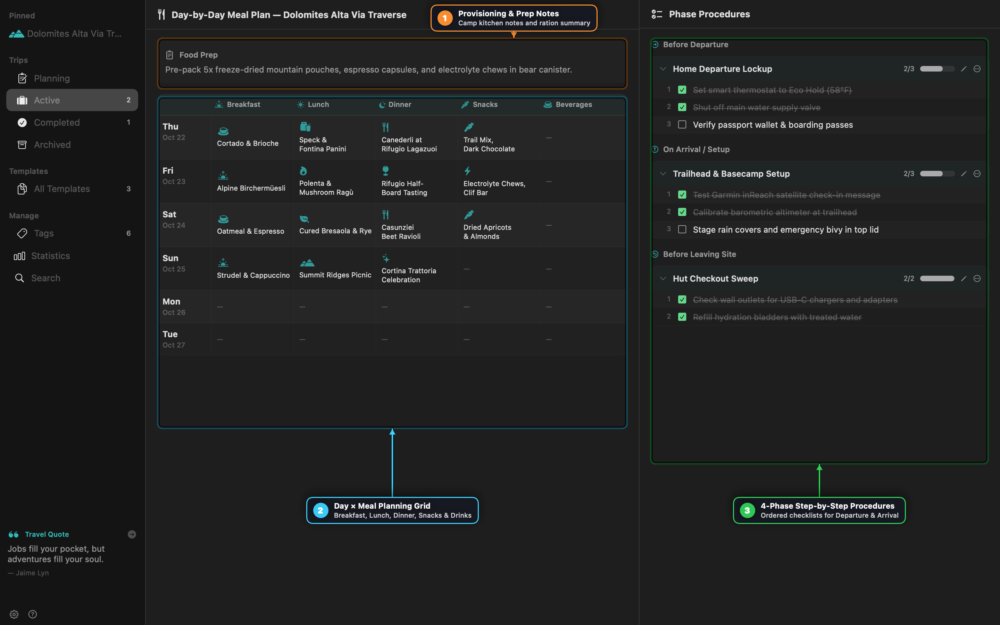
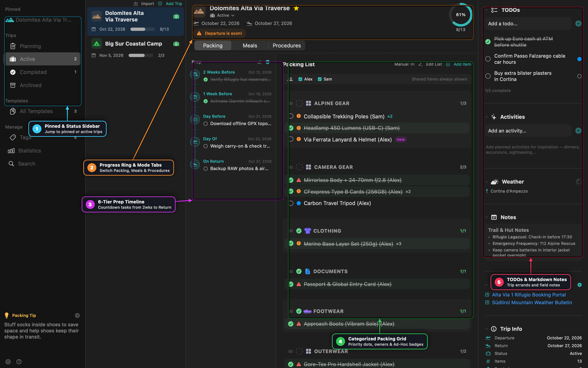
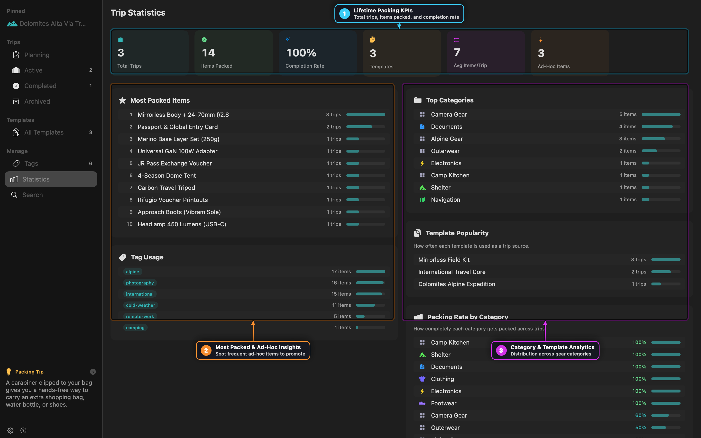

# PackIt Practical Cookbook

Step-by-step workflows for designing modular gear templates, running countdown prep timelines, planning multi-day camp meals, sharing trips with family or teammates, and automating backups with `packit-backup`.

---

## Recipe 1: Designing Modular Composite Templates

Instead of maintaining one giant packing list per destination, split your gear into **Core Sub-Templates** and link them into **Composite Templates**.



### Steps
1. **Create Reusable Sub-Kits (`Cmd+Shift+N`)**:
   - Create **International Travel Core** containing documents (`Passport & Global Entry Card`), power (`Universal GaN 100W Adapter`), and medical basics.
   - Create **Mirrorless Field Kit** containing camera bodies, lenses, CFexpress cards, and tripod.
2. **Create the Master Activity Template**:
   - Create **Dolomites Alpine Expedition** and add activity-specific items (`Gore-Tex Pro Hardshell`, `Approach Boots`, `Garmin inReach Mini 2`).
3. **Link Sub-Templates**:
   - In the **Includes Templates** bar of **Dolomites Alpine Expedition**, click `+` and select **International Travel Core** and **Mirrorless Field Kit**.
4. **Launch a Trip (`Cmd+N`)**:
   - Select **Dolomites Alpine Expedition** when creating your trip. PackIt automatically pulls in every item, prep task, and procedure from the master template and all linked sub-templates, deduplicating any overlapping item names.

---

## Recipe 2: Context-Tag Filtering for Seasonal & Multi-Activity Trips

Use **Context Tags** so a single template adapts automatically to summer vs. winter or solo vs. family travel.

### Steps
1. **Tag Items by Condition**:
   - In your template, tag insulated layers and gloves with `cold-weather`.
   - Tag swimwear and reef sunscreen with `warm-weather`.
   - Leave universal items (`Toothbrush`, `Phone Charger`) untagged.
2. **Filter at Trip Creation (`Cmd+N`)**:
   - Enable **Filter by context tags** in the New Trip sheet.
   - Select `cold-weather` and `photography`.
   - PackIt includes all untagged universal items plus only the tagged items matching your selection, keeping warm-weather gear out of your winter checklist.

---

## Recipe 3: Managing 6-Tier Countdown Prep Tasks & Phase Procedures

Packing is only half of trip readiness. Use **Prep Tasks** for calendar countdown errands and **Procedures** for sequential departure/arrival checklists.



### Steps
1. **Attach Countdown Prep Tasks to Templates**:
   - Add tasks to any of the six timing tiers:
     - **Early (-21d)**: *Renew wilderness permits*
     - **2 Weeks Before (-14d)**: *Confirm hut reservations*
     - **1 Week Before (-7d)**: *Activate satellite SOS plan*
     - **Day Before (-1d)**: *Download offline topo maps & check in*
     - **Day Of (0d)**: *Weigh carry-on luggage*
     - **On Return**: *Ingest RAW photos & dry boots*
   - If your trip dates shift, PackIt automatically recalculates every task's due date.
2. **Execute 4-Phase Procedures**:
   - Switch the trip view to **Procedures**.
   - Step through **Before Departure** (*Shut off main water valve*, *Set thermostat to Eco Hold*), **On Arrival / Setup**, **Before Leaving Site**, and **On Return Home** in strict sequence.

---

## Recipe 4: Multi-Traveler Packing & Bulk Owner Assignment

Coordinate packing across partners or family members without duplicating templates.



### Steps
1. **Add Trip Members**:
   - In the New Trip sheet (or Trip Edit sheet), add travelers (`Alex`, `Sam`, `Shared`).
2. **Bulk Assign or Duplicate (`Cmd+Click`)**:
   - Hold `Cmd` and click multiple items across categories to open the floating bulk action bar.
   - Click **Owner** to assign selected items to `Sam`, or click **Duplicate For...** to create personal copies of essentials (e.g., *Merino Base Layer Set*) for each traveler.
3. **Filter by Traveler**:
   - Click `Alex` or `Sam` in the member filter bar (or press `Cmd+F` and type `owner:Sam packed:no`) to see only that person's remaining unpacked gear.

---

## Recipe 5: Promoting Last-Minute Ad-Hoc Items Back to Templates

Items added directly to a trip are marked with a teal **`new` (Ad-Hoc)** badge so your master templates stay clean until you decide an item is worth keeping permanently.



### Steps
1. **Add Ad-Hoc Gear During a Trip**:
   - Type a new item into the quick-add bar inside an active trip (e.g., `Via Ferrata Lanyard & Helmet`).
2. **Promote Single or Multiple Items**:
   - Right-click any item with a `new` badge and choose **Merge to Template...**, or click the toolbar **Merge Ad-Hoc Items** button to batch-promote new discoveries into your chosen template.
3. **Audit Frequent Ad-Hoc Additions**:
   - Open **Statistics** in the sidebar and review the **Ad-Hoc Insights** card to spot items you repeatedly add at the last minute across multiple trips.

---

## Recipe 6: Selective Folder Sharing & Conflict Resolution

Share specific trips or templates with a travel partner via iCloud Drive, Dropbox, or Syncthing while keeping the rest of your library private.

### Steps
1. **Configure Shared Folder (`Cmd+,`)**:
   - Open **Settings -> Sharing**, set your **Display Name**, and choose a synced folder on disk.
2. **Share Selectively**:
   - Right-click a trip or template and select **Share to Folder**. A **Sharing** badge appears on the item.
3. **Resolve Simultaneous Edits Safely**:
   - If two people edit the same trip before sync completes, PackIt displays a **Conflict Banner** at the top of the trip showing both versions side-by-side so you can choose **Keep Mine** or **Accept Theirs**.

---

## Recipe 7: Automated CLI Backups with `packit-backup`

Automate daily or pre-trip snapshots using the bundled `packit-backup` command-line tool.

```bash
# 1. Create a compressed backup in the default backups directory
packit-backup backup

# 2. Inspect existing backup archives
packit-backup list

# 3. Prune older archives, keeping the latest 15 snapshots
packit-backup prune --keep 15

# 4. Restore a snapshot (automatically saves a pre-restore safety backup first)
packit-backup restore ~/Library/Application\ Support/PackIt/Backups/packit-backup-2026-10-18.tar.gz
```
